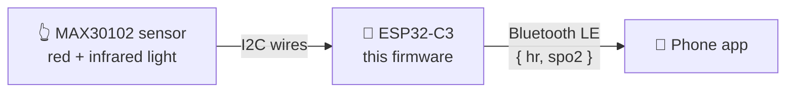

<a id="readme-top"></a>

<div align="center">

<h1>⌚ Smart Bracelet</h1>

<p><strong>A tiny computer you wear on your wrist. It feels your heartbeat and tells your phone.</strong></p>

<p>
  
  
  
  
  
</p>

<p>
  <a href="#-getting-started"><strong>Get started »</strong></a>
  ·
  <a href="https://github.com/Hamed-mohamed-Git/Smart-Bracelet-Embedded-System/issues">Report a bug</a>
  ·
  <a href="https://github.com/Hamed-mohamed-Git/Smart-Bracelet-Embedded-System/issues">Request a feature</a>
</p>

</div>

<details>
  <summary><strong>📑 Table of contents</strong></summary>
  <ol>
    <li><a href="#-explain-it-like-im-5">Explain it like I'm 5</a></li>
    <li><a href="#-about-the-project">About the project</a></li>
    <li><a href="#-how-it-works">How it works</a></li>
    <li><a href="#-hardware">Hardware</a></li>
    <li><a href="#-getting-started">Getting started</a></li>
    <li><a href="#-usage-see-your-heartbeat-on-your-phone">Usage</a></li>
    <li><a href="#-project-structure">Project structure</a></li>
    <li><a href="#-roadmap">Roadmap</a></li>
    <li><a href="#-contributing">Contributing</a></li>
    <li><a href="#-license">License</a></li>
    <li><a href="#-contact">Contact</a></li>
    <li><a href="#-acknowledgments">Acknowledgments</a></li>
  </ol>
</details>

---

## 🧸 Explain it like I'm 5

You know the little clip a doctor puts on your finger to check your heart? This bracelet does the same job, but it's small enough to wear.

It does three things, over and over:

1. 👀 **Look.** A small sensor shines a red light and an invisible light into your skin.
2. 🧮 **Count.** Every time your heart pumps, your blood changes how much light comes back. A tiny computer watches that and works out:
   - ❤️ **how fast your heart beats** (beats per minute)
   - 🫁 **how much oxygen is in your blood** (a percentage, called SpO2)
3. 📣 **Tell.** It sends those two numbers to your phone over Bluetooth, every few seconds.

**Look → Count → Tell → repeat.** That's the whole project. 🔁

> [!WARNING]
> This is a learning project. It is **not a medical device**. Don't use it to make health decisions.

<p align="right">(<a href="#readme-top">back to top</a>)</p>

---

## 💡 About the project

This repository is the **firmware** (the program that runs on the chip) for the bracelet.

It runs on an **ESP32-C3** board, reads a **MAX30102** pulse-oximeter sensor over **I2C**, works out heart rate and SpO2 with Maxim's algorithm, packs the result into a small **JSON** message, and pushes it to a connected phone with **Bluetooth Low Energy (BLE) notifications**.

It is designed to work with a companion Android app (Kotlin + Jetpack Compose) that finds the bracelet, connects to it and shows the live readings.

### ✨ Features

- ❤️ Heart rate and 🫁 SpO2 from a MAX30102 sensor
- 🔄 A rolling buffer of samples, so a fresh reading is ready about every second once it has warmed up
- 📦 Each reading is sent as a tiny JSON message
- 📡 A Bluetooth LE server built on **NimBLE** (it uses much less memory than the default ESP32 Bluetooth library)
- 🛟 Doesn't crash if the sensor is missing. It keeps running and says so in the serial monitor

### 🧰 Built with

| Tool | What it does here |
|---|---|
| [ESP32-C3](https://www.espressif.com/en/products/socs/esp32-c3) | The little computer (microcontroller) with Bluetooth built in |
| [MAX30102](https://www.analog.com/en/products/max30102.html) | The sensor that shines light into your skin |
| C++ with the [Arduino framework](https://docs.platformio.org/en/latest/frameworks/arduino.html) | The language and toolkit the firmware is written in |
| [PlatformIO](https://platformio.org/) | Builds the code and uploads it to the board |
| [SparkFun MAX3010x library](https://github.com/sparkfun/SparkFun_MAX3010x_Sensor_Library) | Talks to the sensor and provides the heart rate / SpO2 algorithm |
| [NimBLE-Arduino](https://github.com/h2zero/NimBLE-Arduino) | A lightweight Bluetooth Low Energy library |

<p align="right">(<a href="#readme-top">back to top</a>)</p>

---

## 🔧 How it works



Inside the chip, `loop()` in [`src/main.cpp`](src/main.cpp) does this:

| Step | What happens | Where |
|---|---|---|
| 1. Collect | Reads one red and one infrared value whenever the sensor has one (about 100 per second) | `PulseSensor::collectSample()` |
| 2. Calculate | Once it has at least 75 samples and a second has passed, it works out heart rate and SpO2 | `PulseSensor::calculateIfReady()` |
| 3. Pack | Turns the numbers into a JSON message | `PulsePayload` |
| 4. Send | Sends the message over Bluetooth, but only if a phone is connected | `BLEManager::sendPayload()` |
| 5. Rest | Waits 3.5 seconds, then starts again | `main.cpp` |

<p align="right">(<a href="#readme-top">back to top</a>)</p>

---

## 🔌 Hardware

### What you need

| Part | Why |
|---|---|
| ESP32-C3-DevKitM-1 board | The brain |
| MAX30102 sensor module | The heartbeat sensor |
| USB cable | To power the board and upload the code |
| 4 jumper wires | To connect the sensor to the board |

### Wiring

Connect four wires. That's all.

| MAX30102 pin | ESP32-C3 pin |
|---|---|
| `VIN` | `3V3` |
| `GND` | `GND` |
| `SDA` | `GPIO 8` |
| `SCL` | `GPIO 9` |

> [!TIP]
> Want to use different pins? Change the numbers in `new PulseSensor(8, 9)` inside [`src/main.cpp`](src/main.cpp). The first number is SDA, the second is SCL.

<p align="right">(<a href="#readme-top">back to top</a>)</p>

---

## 🚀 Getting started

### Prerequisites

- [VS Code](https://code.visualstudio.com/) with the [PlatformIO extension](https://platformio.org/install/ide?install=vscode), **or** the [PlatformIO command line](https://docs.platformio.org/en/latest/core/installation/index.html)
- The hardware above, wired up

### Installation

1. Clone the repository
   ```sh
   git clone https://github.com/Hamed-mohamed-Git/Smart-Bracelet-Embedded-System.git
   cd Smart-Bracelet-Embedded-System
   ```
2. Plug the board into your computer with the USB cable.
3. Build the code and upload it to the board. PlatformIO downloads the libraries for you the first time.
   ```sh
   pio run --target upload
   ```
4. Open the serial monitor to see what the bracelet is doing:
   ```sh
   pio device monitor
   ```

If everything works, you'll see something like this (your numbers will be different):

```text
Starting...
ESP32 BLE MAC: xx:xx:xx:xx:xx:xx
BLE advertising started...
I2C started
MAX30102 ready...
System ready...
HR: 72 | SPO2: 98 | BLE payload: {"hr":72,"spo2":98,"validHr":1,"validSpo2":1}
```

> [!NOTE]
> Seeing `Sensor not found` and then `Running without sensor...`? Check the four wires, especially SDA and SCL.

<p align="right">(<a href="#readme-top">back to top</a>)</p>

---

## 📱 Usage: see your heartbeat on your phone

No app yet? Use the free **nRF Connect** app ([Android](https://play.google.com/store/apps/details?id=no.nordicsemi.android.mcp) / [iOS](https://apps.apple.com/app/nrf-connect-for-mobile/id1054362403)):

1. Open nRF Connect and tap **Scan**.
2. Find **`Smart Bracelet Mawadah`** and tap **Connect**.
3. Open the service `12345678-1234-1234-1234-1234567890ab`.
4. On the characteristic `abcdefab-1234-1234-1234-abcdefabcdef`, tap the **subscribe** button (the ⬇️ arrows).
5. Put your finger on the sensor and keep still. A new message arrives every few seconds. 🎉

### 📨 What the message means

```json
{ "hr": 72, "spo2": 98, "validHr": 1, "validSpo2": 1 }
```

| Field | Meaning |
|---|---|
| `hr` | ❤️ Heart rate in beats per minute |
| `spo2` | 🫁 Oxygen in your blood, in % |
| `validHr` | `1` = the heart rate is trustworthy, `0` = ignore it (for example, your finger moved) |
| `validSpo2` | `1` = the SpO2 is trustworthy, `0` = ignore it |

Before anything is measured, the characteristic simply says `{"status":"waiting"}`.

<p align="right">(<a href="#readme-top">back to top</a>)</p>

---

## 🗂️ Project structure

```text
Smart-Bracelet-Embedded-System/
├── platformio.ini            ⚙️  Board, framework and libraries
├── include/
│   ├── ble/
│   │   ├── ble_manager.h     📡 Starts Bluetooth and sends messages
│   │   └── ble_callbacks.h   🔔 Notices when a phone connects or disconnects
│   ├── pulse_sensor.h        👆 Talks to the MAX30102 sensor
│   ├── pulse_payload.h       📦 Turns a reading into JSON
│   └── json_builder.h        🧱 A tiny JSON builder (no extra library needed)
└── src/
    ├── main.cpp              🧠 setup() and loop(): Look → Count → Tell
    ├── pulse_sensor.cpp
    └── ble/
        ├── ble_manager.cpp
        └── ble_callbacks.cpp
```

<p align="right">(<a href="#readme-top">back to top</a>)</p>

---

## 🗺️ Roadmap

- [x] Read heart rate and SpO2 from the MAX30102
- [x] Send readings to a phone over Bluetooth LE
- [ ] Replace the placeholder Bluetooth UUIDs with real random ones
- [ ] Report battery level
- [ ] Sleep between readings to save battery
- [ ] Add unit tests in `test/`

See the [open issues](https://github.com/Hamed-mohamed-Git/Smart-Bracelet-Embedded-System/issues) for ideas and known problems.

<p align="right">(<a href="#readme-top">back to top</a>)</p>

---

## 🤝 Contributing

Ideas and fixes are welcome.

1. Fork the project
2. Create your branch (`git checkout -b feature/amazing-feature`)
3. Commit your changes (`git commit -m 'Add amazing feature'`)
4. Push the branch (`git push origin feature/amazing-feature`)
5. Open a pull request

<p align="right">(<a href="#readme-top">back to top</a>)</p>

---

## 📄 License

No license has been chosen yet, so all rights are reserved by the author. Open an issue if you'd like to use this code.

---

## 📬 Contact

**Hamed Mohamed**: [LinkedIn](https://www.linkedin.com/in/hamed-mohamed-hamed/) · [GitHub](https://github.com/Hamed-mohamed-Git)

Project link: [github.com/Hamed-mohamed-Git/Smart-Bracelet-Embedded-System](https://github.com/Hamed-mohamed-Git/Smart-Bracelet-Embedded-System)

---

## 🙏 Acknowledgments

- [SparkFun MAX3010x Sensor Library](https://github.com/sparkfun/SparkFun_MAX3010x_Sensor_Library)
- [NimBLE-Arduino](https://github.com/h2zero/NimBLE-Arduino)
- [PlatformIO](https://platformio.org/)
- [Best-README-Template](https://github.com/othneildrew/Best-README-Template), which this README is based on
- [Shields.io](https://shields.io/) for the badges

<p align="right">(<a href="#readme-top">back to top</a>)</p>
